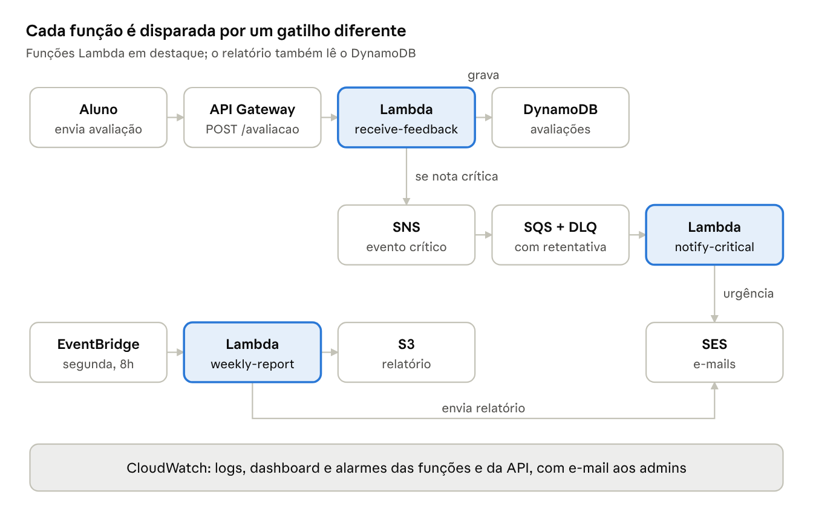
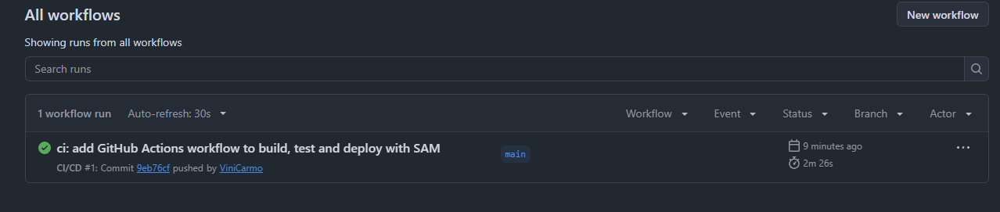
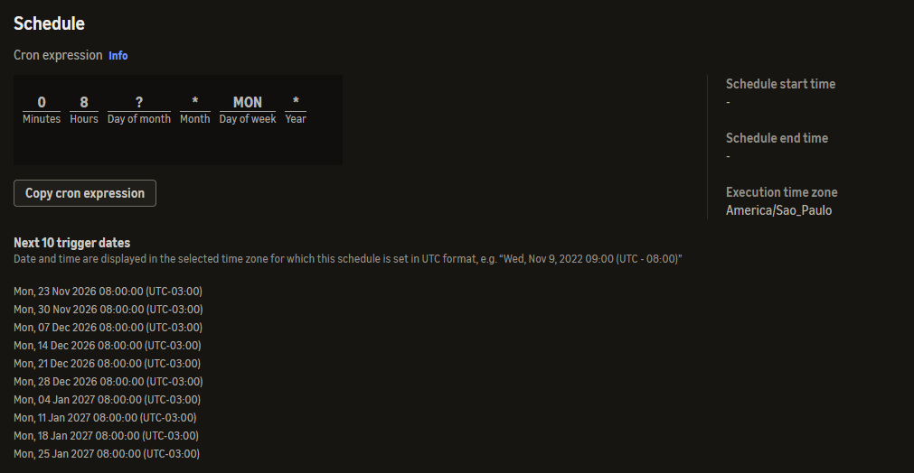

# Feedback Platform Serverless

Plataforma de feedback de aulas construída com **Java 21, Quarkus e AWS Lambda**. Estudantes avaliam as aulas com uma nota de 0 a 10 e uma descrição; administradores recebem um **e-mail imediato** quando uma avaliação é crítica e um **relatório semanal** com a média das notas e as contagens por dia e por urgência.

Projeto da **Fase 4 (Serverless Strategist)** do Tech Challenge da Pós-Graduação em Arquitetura e Desenvolvimento Java da FIAP.

## Arquitetura



Três funções Lambda, cada uma com uma única responsabilidade e um gatilho diferente:

| Função | Gatilho | Responsabilidade |
|---|---|---|
| `receive-feedback` | API Gateway: `POST /avaliacao` | Valida, classifica a urgência, grava no DynamoDB e publica no SNS se for crítica |
| `notify-critical-feedback` | Fila SQS (assinante do tópico SNS, com DLQ) | Envia o e-mail de urgência pelo SES |
| `generate-weekly-report` | EventBridge Scheduler: segunda-feira, 8h (America/Sao_Paulo) | Gera o relatório da semana, grava no S3 e envia pelo SES |

Regra de urgência: nota **0 a 3** → `CRITICAL` (dispara e-mail), **4 a 6** → `MEDIUM`, **7 a 10** → `LOW`.

## Tecnologias

- **Backend:** Java 21, Quarkus, Quarkus Amazon Lambda, AWS SDK for Java v2, Jackson, JUnit 5
- **AWS:** Lambda, API Gateway, DynamoDB, SNS, SQS, SES, S3, EventBridge Scheduler, CloudWatch, IAM
- **Infraestrutura e entrega:** AWS SAM, CloudFormation, GitHub Actions, Maven (multi-módulo)
## Estrutura do projeto

```text
feedback-platform-serverless/
├── domain/                      # Entidades, casos de uso e gateways em Java puro (sem framework/AWS)
├── function-receive-feedback/   # Lambda HTTP: handler, adaptadores DynamoDB e SNS
├── function-notify-critical/    # Lambda SQS: handler, adaptador SES
├── function-weekly-report/      # Lambda agendada: handler, adaptadores DynamoDB, S3 e SES
├── template.yaml                # Toda a infraestrutura (AWS SAM)
└── .github/workflows/deploy.yml # CI/CD
```

O módulo `domain` não depende de nenhum framework: os casos de uso dependem apenas de interfaces (gateways), implementadas pelos adaptadores de cada função e montadas via `@Produces` (Clean Architecture).

## Endpoint

`POST /avaliacao`, protegido por API Key no cabeçalho `x-api-key`.

```json
{ "descricao": "O audio cortava o tempo todo", "nota": 2 }
```

| Situação | Status |
|---|---|
| Avaliação registrada | `201 Created` (retorna `id`, `urgency` e `submittedAt`) |
| Nota fora de 0 a 10, descrição vazia ou JSON inválido | `400 Bad Request` |
| Sem API Key ou chave inválida | `403 Forbidden` |

## Como implantar

**Pré-requisitos:** Java 21, AWS CLI e AWS SAM CLI, conta AWS configurada (`aws configure`) e os e-mails de remetente e destinatário verificados no Amazon SES.

```bash
git clone https://github.com/ViniCarmo/feedback-platform-serverless.git
cd feedback-platform-serverless
 
./mvnw clean verify
 
sam deploy --parameter-overrides "SenderEmail=<remetente>" "RecipientEmails=<destinatario>"
```

Os e-mails são parâmetros do template para não ficarem no repositório. A URL da API aparece nos **Outputs** do deploy.

## Como testar

```bash
# API Key
aws apigateway get-api-keys --include-values --query "items[0].value" --output text
 
# Avaliação crítica (dispara o e-mail de urgência)
curl -X POST <ApiUrl> -H "x-api-key: <API_KEY>" -H "Content-Type: application/json" \
  -d '{"descricao":"O audio cortava o tempo todo","nota":2}'
 
# Relatório semanal sob demanda (período: 7 dias anteriores à data de referência)
sam remote invoke GenerateWeeklyReportFunction --stack-name feedback-platform \
  --event '{"referenceDate":"2026-11-17"}'
```


## CI/CD

A cada push na `main`, o GitHub Actions compila o projeto, executa os **45 testes** e, se todos passarem, publica na AWS com `sam deploy`. Pull requests rodam apenas build e testes; mudanças só em documentação não disparam o pipeline. Credenciais e e-mails ficam nos **Secrets** do GitHub.



## Infraestrutura como código

Todo recurso da AWS é criado pelo `template.yaml`; nada foi configurado manualmente no console.


## Segurança

- API protegida por **API Key** com **Usage Plan** (limite de requisições)
- **Uma política IAM por função**, com permissões mínimas
- Criptografia em repouso no DynamoDB, S3 e SQS; bucket com **acesso público bloqueado**
- Credenciais e e-mails fora do código (Secrets do GitHub e parâmetros do deploy)
- Logs sem a descrição das avaliações (possível dado pessoal)
## Monitoramento

CloudWatch com logs por função (retenção de 14 dias), dashboard `feedback-platform` e **5 alarmes** por e-mail:

| Alarme | Dispara quando |
|---|---|
| `feedback-receive-feedback-errors` | A `receive-feedback` registra erro |
| `feedback-notify-critical-errors` | A `notify-critical-feedback` registra erro |
| `feedback-weekly-report-errors` | A `generate-weekly-report` registra erro |
| `feedback-critical-dlq-not-empty` | Um alerta crítico falhou 3 vezes e chegou à DLQ |
| `feedback-api-5xx` | A API retorna erro de servidor |


## Relatório semanal agendado



## Autor

**Vinicius Oliveira do Carmo** · RM370572 · Pós Tech 12ADJT
 